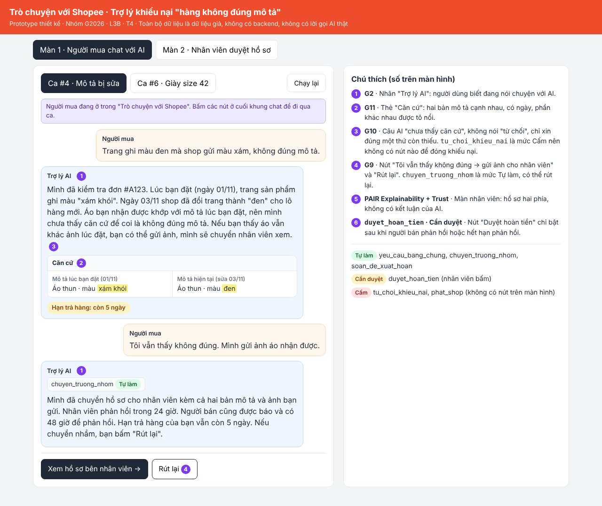
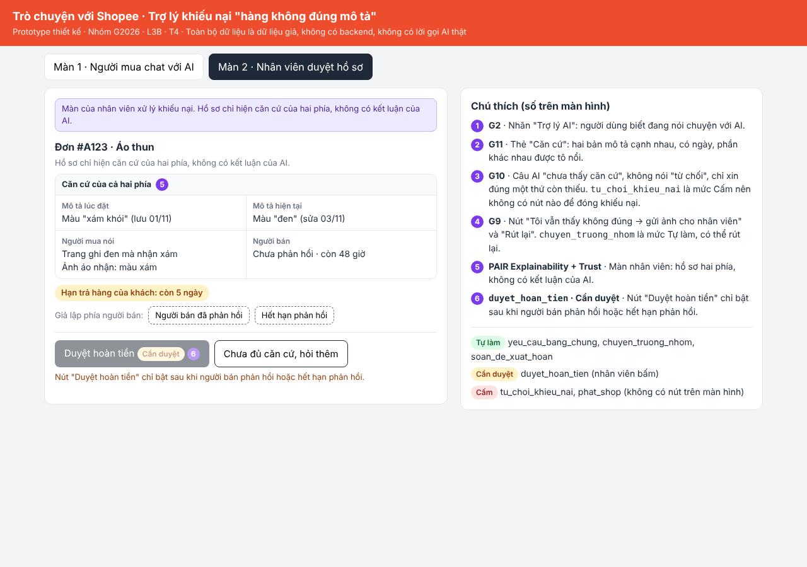

# Prototype — T4 · Nhóm G2026

- **Link / file:** [`prototype/index.html`](index.html). Mở bằng trình duyệt, không cần cài đặt. Chi tiết 2 màn hình và 6 quyết định ở `spec.md` §5.
- **Công cụ:** HTML/CSS/JS thuần, một file. Toàn bộ dữ liệu là dữ liệu giả (đơn #A123, #B456, hai bản mô tả, phản hồi người bán, hạn trả hàng 5 ngày, hạn phản hồi 48 giờ).
- **Ca khó được dựng:** #4, mô tả đã bị sửa sau khi bán (xám khói → đen). Có thêm tab #6 (giày size 42, người bán đúng) để thử nhánh "còn thiếu 1 mục" và nhánh `soan_de_xuat_hoan`.
- **Có lời gọi AI thật không:** Không. Câu AI viết sẵn, không có backend, không có API key.

## Cách thử (ca #4)

1. Màn 1: bấm **"Tôi vẫn thấy không đúng → gửi ảnh cho nhân viên"**. Có thể bấm **"Rút lại"** để quay về.
2. Bấm **"Xem hồ sơ bên nhân viên →"** để sang Màn 2.
3. Màn 2: nút **"Duyệt hoàn tiền"** đang khoá. Bấm **"Người bán đã phản hồi"** hoặc **"Hết hạn phản hồi"** (giả lập phía người bán) để mở nút.
4. Bấm **"Duyệt hoàn tiền"**. Quay lại Màn 1: nút "Rút lại" biến mất, chat báo hồ sơ đã đóng.

Nút **"Chạy lại"** ở Màn 1 đưa mọi thứ về trạng thái ban đầu.

## Ảnh đánh số

| Số | Thể hiện gì | Nguyên tắc HAX/PAIR | Mức tự chủ |
| --- | --- | --- | --- |
| 1 | Nhãn "Trợ lý AI" (Màn 1) | G2 | — |
| 2 | Thẻ "Căn cứ": hai bản mô tả cạnh nhau, có ngày, tô phần thay đổi (Màn 1) | G11 | — |
| 3 | Câu AI "chưa thấy căn cứ", không nói "từ chối"; ở #6 có thẻ "Còn thiếu (1 mục)" (Màn 1) | G10 | `tu_choi_khieu_nai` cấm, không có nút |
| 4 | Nút "Tôi vẫn thấy không đúng → gửi ảnh cho nhân viên" và "Rút lại" (Màn 1) | G9 | `chuyen_truong_nhom` tự làm, có "Rút lại" |
| 5 | Hồ sơ hai phía, không có kết luận của AI (Màn 2) | PAIR Explainability + Trust | — |
| 6 | Nút "Duyệt hoàn tiền" chỉ bật sau khi người bán phản hồi hoặc hết hạn (Màn 2) | — | `duyet_hoan_tien` cần duyệt |

Ảnh 1 chụp sau khi bấm chuyển nhân viên (thấy "Rút lại"). Ảnh 2 chụp lúc nút "Duyệt hoàn tiền" còn khoá.
